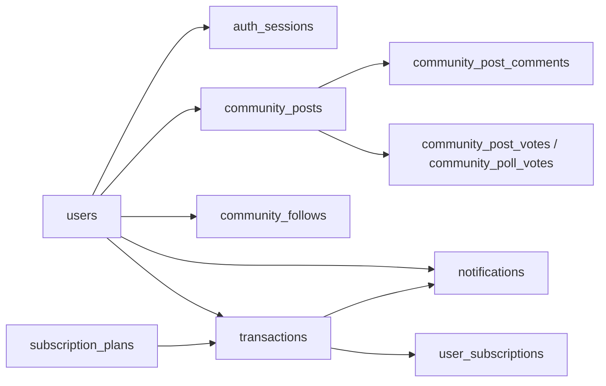

# BÁO CÁO CÔNG VIỆC CÁ NHÂN TRONG ĐỒ ÁN ZFLIX

> Mốc kiểm kê ban đầu: nhánh `Du`, HEAD `862ef2f`, ngày 14/11/2026. Phần cập nhật ngày 21/11/2026 ở mục 4.4 đối chiếu công việc trong phiên này với source và kết quả kiểm tra thực tế; các thay đổi mới còn ở working tree, chưa commit. Báo cáo phân biệt phần đóng góp cá nhân đã có bằng chứng Git với phần triển khai trong phiên, không nhận toàn bộ ZFLIX là công việc cá nhân.

## Bảng kiểm kê đóng góp trước khi viết báo cáo

Identity Git được đối chiếu là `23tmln <156797309+23tmln@users.noreply.github.com>`: cấu hình `git config user.*` trên nhánh `Du` trùng identity của các commit xác thực, cộng đồng, thông báo và VIP. `git shortlog -sne --all` ghi 39 commit dưới identity này; các identity còn thấy là `Ngoc`, `Lilstormy`, `namnguyen151005`, `Khoa`. Hai chuỗi hash khác nhau của một số checkpoint bảo mật xuất hiện trên các nhánh khác nhau; không cộng chúng thành hai lần triển khai. Nhánh hiện hành `Du` theo dõi `origin/Du`; lịch sử còn có `integration`, `main` và các nhánh thành viên. Working tree sạch trước khi tạo tài liệu này.

| Phần việc | Phân loại | Căn cứ và ranh giới nhận công |
| --- | --- | --- |
| Quản lý tài khoản, xác thực và bảo mật | **Trực tiếp** | Các checkpoint `a2a84cf`, `feb1fc4`, `32a6add`, `00de989`, `c61103d`, `318f6dd`, `2946c00`, `8988504`, `55430bf`; blame route/service/UI xác nhận các thay đổi. Chỉ nhận các luồng và lớp bảo vệ đã xây dựng; trang quản trị người dùng do thành viên khác tạo không được nhận toàn bộ. |
| Cộng đồng/diễn đàn bài viết, câu hỏi cảnh phim, hồ sơ/follow | **Trực tiếp trên các phần liệt kê** | `aa625a0`, `f3a1a2f`, `7e8416d`, `61d240a`; blame `CommunityPage.jsx`, `posts.routes.js`, schema. Không nhận toàn bộ comment/rating phim, thư viện, player hoặc module khám phá vốn có lịch sử khác. |
| Thông báo P0/P1 | **Trực tiếp** | `35ff656`, phần thông báo trong `61d240a`; blame `NotificationBell.jsx`, `notification.service.js`, test và tài liệu. Các điểm móc vào tập phim, auth, admin là tích hợp thông báo, không phải sở hữu toàn bộ nghiệp vụ đó. |
| VIP và thanh toán chuyển khoản thủ công | **Trực tiếp đối với luồng đặt đơn/duyệt, UI, nhận diện VIP** | `862ef2f` tạo `payments/`, trang `/vip`, trang xét duyệt và test. VIP entitlement/playback token có commit `7fb3966` của `Ngoc`; báo cáo chỉ nêu nó như phụ thuộc. Cấp VIP thủ công trước đó thuộc mã quản trị chung; ở commit này chỉ nhận thay đổi audit/lý do và tích hợp. |
| Trang chủ / Hero Banner | **Cùng thực hiện; chỉ nhận phần thay đổi của mình** | `862ef2f` tạo `HeroBanner.jsx`, sửa `HomePage.jsx` và `/productions/top`. `HomePage.jsx` và khám phá phim đã có trước, có commit của `Lilstormy`, `Ngoc`; không nhận toàn bộ trang chủ, tìm kiếm hay danh mục. |
| AI Chatbot | **Thành viên khác** | Người thực hiện xác nhận. Dù commit tích hợp `61d240a` mang identity `23tmln` và chứa nhiều file chatbot, không suy ra tác quyền xây dựng chatbot từ commit gom mã. |
| Xem phim/trình phát và quản trị phim/tập | **Thành viên khác** | Người thực hiện xác nhận; Git có các commit `Ngoc` và `namnguyen151005`. Các chỉnh sửa nhỏ cho deep link thông báo hoặc hiển thị cộng đồng chỉ được ghi đúng phạm vi tích hợp. |
| Quyền tác giả của một số đoạn di sản/merge khác | **Chưa xác định ở cấp dòng** | Không đưa vào phần công việc cá nhân. Phụ lục ghi các điểm cần làm rõ nếu muốn mở rộng phạm vi sau này. |

## Chương 1. Tổng quan phần công việc cá nhân

### 1.1. Bối cảnh và phạm vi

ZFLIX là website xem phim có frontend React, backend Node.js/Express, dữ liệu MongoDB và một số nhánh tương thích MySQL/Prisma. Hệ thống có nội dung phim, tài khoản, cộng đồng, thông báo và gói VIP. Công việc cá nhân trong báo cáo này gồm: (1) tài khoản và bảo mật, (2) bài viết cộng đồng và các tương tác được kiểm chứng, (3) thông báo, (4) đơn VIP thanh toán chuyển khoản cần người xét duyệt, (5) phần Hero Banner trên trang chủ. Đây là năm mảng có mức sở hữu khác nhau; riêng Hero thuộc phần làm chung.

### 1.2. Công nghệ trực tiếp sử dụng

React, React Router, state/effect và context cho giao diện; Express router/middleware cho API; MongoDB collection, index và transaction cho community, notification, VIP; Socket.IO namespace cho thông báo thời gian thực; JWT, refresh cookie, bcrypt, TOTP và rate limit cho bảo mật; Node test/integration smoke cho các luồng tương ứng. Nhánh auth còn hỗ trợ MySQL; cấu hình `DATA_STORE` quyết định service được nạp trong `auth.routes.js`. Không khẳng định mọi môi trường triển khai đều dùng MongoDB hoặc các script test đã chạy trên production.

### 1.3. Phụ thuộc của thành viên khác

Giao diện Hero sử dụng catalog/phim và route chi tiết có sẵn. Cộng đồng liên kết phim, tập, ảnh và đăng nhập; các hệ đó là phụ thuộc. Thông báo móc vào phát hành tập, bình luận phim, cấp VIP và socket dùng chung. VIP sử dụng `requireAuth`, dữ liệu `subscription_plans` sẵn có và quyền xem phim VIP đã có. AI Chatbot, player/HLS, quản trị phim/tập và toàn bộ phần discovery cũ không thuộc phạm vi nhận công.

## Chương 2. Phân tích và thiết kế

### 2.1. Yêu cầu chức năng và use case

| Mã | Tác nhân | Use case | Điều kiện/đầu ra chính |
| --- | --- | --- | --- |
| UC01 | Khách/thành viên | Đăng ký, đăng nhập, quên/đặt lại mật khẩu | Dữ liệu hợp lệ; mật khẩu được băm, phiên được cấp hoặc challenge MFA nếu bật. |
| UC02 | Thành viên | Quản lý MFA, đổi mật khẩu, xem/thu hồi phiên | API kiểm tra session, Origin và quyền sở hữu; thay đổi nhạy cảm thu hồi phiên thích hợp. |
| UC03 | Thành viên | Viết, sửa, lưu, bình chọn, bình luận, báo cáo bài; theo dõi tác giả | Quyền đọc theo visibility; chỉ người có quyền mới ghi; hồ sơ công khai không tiết lộ email. |
| UC04 | Thành viên | Xem và điều chỉnh thông báo | Danh sách, số chưa đọc, đọc/xóa và preference gắn với user từ session. |
| UC05 | Thành viên | Chọn gói VIP, tạo đơn và xác nhận đã chuyển khoản | Đơn `PENDING` chuyển sang `WAITING_REVIEW`; chưa tự kích hoạt VIP. |
| UC06 | Admin/Moderator | Xét duyệt hoặc từ chối đơn | Duyệt trong transaction, cập nhật hạn VIP và thông báo; Admin mới sửa giá gói. |
| UC07 | Khách/thành viên | Xem phim nổi bật trên Hero | Dữ liệu từ API top phim; chuyển slide và truy cập trang phim có sẵn. |

### 2.2. Luồng nghiệp vụ và ranh giới phân quyền

```mermaid
sequenceDiagram
    actor User as Thành viên
    participant UI as React
    participant API as Express API
    participant DB as MongoDB
    participant Staff as Admin/Moderator
    User->>UI: Chọn gói VIP
    UI->>API: POST /api/v1/vip/orders {planId}
    API->>DB: Đọc subscription_plans; tạo transactions PENDING
    DB-->>API: Đơn + snapshot giá/ngân hàng
    API-->>UI: Mã đơn, trạng thái, QR LIVE/DEMO
    User->>UI: Xác nhận đã chuyển khoản
    UI->>API: POST /api/v1/vip/orders/:id/submit
    API->>DB: PENDING -> WAITING_REVIEW (đúng chủ đơn)
    Staff->>API: POST /api/v1/admin/vip-payments/orders/:id/review
    API->>DB: Transaction: đổi trạng thái, hạn VIP, subscription, notification
    API-->>UI: PAID hoặc REJECTED
```

Đối với auth, `ProtectedRoute` giúp điều hướng giao diện; backend `requireAuth` đọc lại người dùng/phiên từ cơ sở dữ liệu và middleware role quyết định quyền thực. Đối với cộng đồng, GET chỉ trả nội dung active mà người xem được phép đọc; các POST/PATCH/DELETE đòi session và kiểm tra tác giả hoặc vai trò kiểm duyệt. Đối với VIP, người dùng chỉ đọc/tạo/gửi đơn của mình, nhân viên xét duyệt, Admin mới sửa gói. QR `DEMO` là minh họa khi thiếu cấu hình ngân hàng; không xác nhận giao dịch tiền tự động.

### 2.3. Thiết kế API đang có trong source

Prefix được ghép trong `backend-node/src/app.js`. Các ví dụ dưới đây là route hiện có, không phải API dự kiến.

| Nhóm | API tiêu biểu | Tác dụng |
| --- | --- | --- |
| Auth | `POST /api/v1/auth/register`, `/login`, `/refresh-token`, `/logout`, `/logout-all`, `/logout-others`; `GET /api/v1/auth/me`, `/sessions` | Vòng đời tài khoản và session. |
| Auth nâng cao | `POST /api/v1/auth/forgot-password`, `/reset-password`, `/change-password`, `/mfa/setup`, `/mfa/enable`, `/mfa/verify`, `/mfa/disable`, `/mfa/recovery-codes/regenerate`; `GET /api/v1/auth/mfa/status`; `DELETE /api/v1/auth/sessions/:sessionId` | Khôi phục mật khẩu, MFA, thu hồi phiên. |
| Cộng đồng | `GET/POST /api/v1/community/posts`; `GET/PATCH/DELETE /api/v1/community/posts/:id`; `POST /with-images`; `PUT /:id/vote`, `/:id/poll-vote`, `/:id/save`; `GET/POST /:id/comments`; `POST /:id/reports` | Bài viết, ảnh, poll, lưu, bình luận, báo cáo. `GET /saved` và các route bình luận con cũng có trong `posts.routes.js`. |
| Hồ sơ | `GET /api/v1/community/users/:id`, `PATCH /api/v1/community/users/me`, `PUT/DELETE /api/v1/community/users/:id/follow`, `GET /:id/followers`, `/:id/following`, `/:id/activity` | Hồ sơ và mạng theo dõi. |
| Thông báo | `GET /api/v1/notifications`, `/unread-count`, `/preferences`; `PATCH /preferences`, `/:notificationId/read`, `/read-all`; `DELETE /:notificationId` | Danh sách, trạng thái đọc, xóa và lựa chọn loại thông báo. |
| VIP | `GET /api/v1/vip/plans`, `/orders`; `POST /api/v1/vip/orders`, `/orders/:id/submit`; `GET /api/v1/admin/vip-payments/orders`; `POST /api/v1/admin/vip-payments/orders/:id/review`; `PUT /api/v1/admin/vip-payments/plans/:id` | Đơn chuyển khoản, xét duyệt và sửa gói. |
| Hero | `GET /api/v1/productions/top` | Cấp dữ liệu cho carousel phim nổi bật. |

### 2.4. Dữ liệu và quan hệ liên quan

| Collection/bảng | Trường được source dùng | Quan hệ/vai trò |
| --- | --- | --- |
| `users` | `id`, `username`, `email`, `password` (giá trị bcrypt ở nhánh Mongo), `status`, `vip_expires_at`, `notification_preferences`, các trường MFA/khóa tài khoản | Chủ session, bài viết, đơn và thông báo; không trả thông tin nhạy cảm ở hồ sơ công khai. |
| `auth_sessions`, `password_reset_tokens` và dữ liệu MFA | `user_id`, refresh hash, hạn dùng/thu hồi; reset token hash/challenge/recovery | Vòng đời đăng nhập, khôi phục, MFA. Nhánh MySQL có migration tương ứng; Mongo service tạo index theo source. |
| `community_posts` | `author_id`, `type`, `content_type`, `title`, `content`, `visibility`, `status`, `production_id`, `episode_id`, `images`, `category`, `poll_options`, bộ đếm | Bài thường, bài ảnh và câu hỏi cảnh phim; `content_type` tách câu hỏi cảnh khỏi bảng tin. |
| `community_post_comments`, `community_post_votes`, `community_poll_votes`, `community_saved_posts`, `community_reports`, `community_follows` | Khóa post/user/comment và trạng thái tương ứng | Bình luận, vote một lần theo cặp khóa, lưu bài, báo cáo và quan hệ theo dõi. |
| `notifications`, `notification_like_events`, `notification_jobs` | `user_id`, loại, nội dung, `redirect_url`, `is_read`, `deduplication_key`; sự kiện like/job | Hộp thư, chống trùng và xử lý sự kiện nền. |
| `subscription_plans`, `transactions`, `user_subscriptions` | Gói/giá/tháng; đơn, snapshot giá, trạng thái, lịch sử; kỳ VIP và `transaction_id` | Duyệt đơn liên kết user, gói và subscription. `vip_expires_at` trên user được cập nhật sau khi duyệt. |

Các collection có thể chứa trường di sản hoặc trường do người khác thêm. Bảng chỉ liệt kê trường thiết yếu cho các luồng báo cáo; không tuyên bố sở hữu toàn bộ schema `users`, catalog hoặc dữ liệu phim.



## Chương 3. Xây dựng các chức năng

### 3.1. Quản lý tài khoản và bảo mật

**Mục đích và trạng thái.** Cung cấp đăng ký/đăng nhập, phiên truy cập, thay đổi/khôi phục mật khẩu, MFA và quản lý phiên. Source có đủ route và giao diện; các checkpoint auth đã có kiểm thử lịch sử, nhưng lần viết báo cáo này chỉ đọc source/Git. Auth MongoDB được bổ sung tại `e68cde8`; nhánh MySQL cũ vẫn hiện diện nên không mô tả là đã loại bỏ hoàn toàn.

**Frontend.** `LoginPage`, `RegisterPage`, `ForgotPasswordPage`, `ResetPasswordPage`, `AccountSecurityPage`, `SettingsPage`, `ProfilePage` và `AuthContext` xử lý form, trạng thái đăng nhập và điều hướng. Route `/login`, `/register`, `/forgot-password`, `/reset-password`, `/settings`, `/account/security` ở `route.jsx`; `/account/profile` chuyển về tab hồ sơ. `AuthContext` giữ access token trong bộ nhớ và refresh khi khởi tạo. Các phần menu/avatar/profile được cải tiến trong `f3a1a2f`; không nhận toàn bộ thiết kế admin user của thành viên khác.

**Backend.** `auth.routes.js` validate email, username, password, gắn limiter/Origin và gọi `auth.mongo.service.js` hoặc `auth.service.js` theo `DATA_STORE`. Đăng nhập kiểm tra mật khẩu, tình trạng tài khoản/khóa tạm; tài khoản bật MFA nhận challenge trước khi có phiên. Refresh token được lưu dạng hash phía server, xoay vòng khi refresh; `requireAuth` kiểm tra session và lấy user hiện tại. Đổi/reset mật khẩu và thao tác MFA/thu hồi session được xử lý tại service, ghi security event ở các điểm tương ứng. Lỗi đầu vào trả 400, sai thông tin 401, trạng thái khóa có 429, vi phạm quyền theo middleware trả 401/403; chi tiết tùy endpoint.

**Dữ liệu và luồng.** `users` liên kết `auth_sessions` qua user ID; collection token/challenge giữ hash và hạn dùng. Trình tự đăng nhập: form → `POST /auth/login` → service đọc user/so bcrypt → nếu cần MFA thì xác minh factor → cấp access token và refresh cookie → request sau qua `requireAuth` đọc lại session/user. Các API quản lý session chỉ thao tác với ID thuộc người đang đăng nhập. File chính: `backend-node/src/modules/auth/auth.routes.js`, `auth.mongo.service.js`, `auth.service.js`, `backend-node/src/core/middleware/auth.middleware.js`, `frontend/src/context/AuthContext.jsx`, `frontend/src/modules/auth/*`, `frontend/src/routes/ProtectedRoute.jsx`.

**Đóng góp cá nhân và giới hạn.** Các commit bảo mật theo phase chứng minh tác giả triển khai auth, hardening, MFA, session và test. `Ngoc` có commit dịch giao diện auth và UI chung; báo cáo không gộp các thay đổi ấy thành phần cá nhân. Email gửi reset trên production, topology Mongo và cấu hình vận hành không được chứng minh chỉ bằng source.

### 3.2. Cộng đồng và diễn đàn phim

**Mục đích và trạng thái.** Tạo không gian bài viết, thảo luận, ảnh, poll, bình luận và theo dõi tác giả. `aa625a0` mở bài viết Mongo, `f3a1a2f` cải tiến UI/quyền và tài khoản, `7e8416d` tách hỏi đáp khoảnh khắc, `61d240a` bổ sung composer, poll, hồ sơ/follow. Các route và UI đang có; một số phần upload/R2, cạnh tranh quyền và dữ liệu di sản còn giới hạn kiểm thử.

**Frontend.** `/community`, `/community/create`, `/community/posts/:id`, `/community/saved`, `/community/scene-questions/:id`, `/community/users/:id` dùng `CommunityPage`, `CommunityComposer`, `CommunityProfilePage`, `PostComments`. Bảng tin có lọc danh mục, tìm kiếm, sắp xếp, phân trang; card hỗ trợ spoiler, ảnh, vote, poll, lưu, bình luận/báo cáo. Hồ sơ hiển thị nội dung công khai, follow và hoạt động theo quyền. State React giữ trang, chế độ khám phá/đang theo dõi, filter, vote/poll và lỗi; request qua `apiRequest`, sau mutation đồng bộ lại dữ liệu hoặc cập nhật state tương ứng.

**Backend.** `posts.routes.js` đọc bài theo visibility/trạng thái, validate nội dung, giới hạn ảnh, kiểm tra tác giả khi sửa và vai trò khi xóa; lưu/vote/poll/comment/report có endpoint riêng. `profiles.routes.js` giới hạn trường công khai, chỉ cho sửa hồ sơ của `req.user.id`, chặn tự follow và dùng khóa cặp user để tránh trùng. `community.schema.js` định nghĩa validator/index cho bài, bình luận, votes, poll, follow, saved, reports. Một bài screenshot phải gắn đúng một ảnh/tập và timestamp; logic cross-document còn được kiểm ở tuyến ghi. `scene_question` tách khỏi `community_post`, cùng post ID cho một nội dung ảnh được chia sẻ. Thông báo tương tác là tích hợp với mục 3.3.

**Luồng.** Thành viên viết nội dung ở composer → gửi `POST /community/posts` hoặc `/with-images` → backend xác thực, validate quyền nhìn thấy/ảnh và lưu bài vào Mongo → feed đọc bài active hợp quyền → người khác có thể vote, poll, lưu, bình luận → API cập nhật collection phụ và trả bộ đếm để UI hiển thị. Các route phim/tập chỉ cung cấp ngữ cảnh; đây không phải công việc xây dựng player. File chính: `posts.routes.js`, `profiles.routes.js`, `community.schema.js`, `post-images.js`, `CommunityPage.jsx`, `CommunityComposer.jsx`, `CommunityProfilePage.jsx`, `PostComments.jsx`, CSS cộng đồng.

### 3.3. Hệ thống thông báo

**Mục đích và trạng thái.** Lưu thông báo bền vững và cập nhật giao diện cho trả lời/bình luận, mention, like, tập mới, bảo mật, VIP; người dùng xem và kiểm soát các loại thông báo cho phép. Commit `35ff656` triển khai P0/P1, `61d240a` bổ sung giao diện/khớp luồng. Tài liệu `docs/NOTIFICATION_P1.md` ghi test lịch sử trên Mongo test riêng.

**Frontend.** `NotificationBell` tải 8 bản ghi gần nhất và unread count, kết nối namespace Socket.IO `/notifications`, tải lại sau reconnect/focus/event. `NotificationsPage` có filter, phân trang, đánh dấu đọc/xóa và deep link; `/notifications` cần đăng nhập. `NotificationPreferencesSection` trong `/settings` hiển thị sáu công tắc. Một số file thảo luận/phim được sửa để truyền `commentId`/`episodeId` và cuộn đúng bình luận đích; đây là sửa tích hợp thông báo, không phải sở hữu trang xem phim.

**Backend và dữ liệu.** `notification.service.js` ghi `notifications` với user nhận, actor, loại, entity, đích, trạng thái đọc, thời gian và khóa dedup. Index theo user/thời gian/unread và unique key chống trùng. Các endpoint list/read/read-all/delete luôn lọc `req.user.id`. Preferences nằm ở `users.notification_preferences`, giá trị thiếu mặc định bật; security và thông báo bắt buộc không phụ thuộc công tắc tương tác. `mention.service.js` xác định người nhận từ username ở server; `like-notification.service.js` dùng `notification_like_events` để cooldown/gộp; `episode-notification.job.js` và `vip-expiration.job.js` tạo thông báo nền, có cơ chế chống gửi lặp. Socket gửi tới room `user:<id>` do server xác định sau xác thực; thông báo được lưu trước khi phát realtime.

**Luồng.** Sự kiện nghiệp vụ → service xác định người nhận, preference và khóa chống trùng → ghi Mongo (trong transaction ở luồng yêu cầu) → phát socket sau ghi/commit → Bell/trang danh sách gọi API để đồng bộ → người dùng mở deep link hoặc cập nhật trạng thái đọc. API lỗi/validation áp dụng cho page, filter, preference và quyền sở hữu. File chính: `notification.service.js`, `notification-preferences.js`, `mention.service.js`, `like-notification.service.js`, hai job, `community.routes.js`, `backend-node/src/server.js`, `NotificationBell.jsx`, `NotificationsPage.jsx`, `NotificationPreferencesSection.jsx`.

### 3.4. Hệ thống VIP và thanh toán

**Mục đích và trạng thái.** Thành viên đặt đơn gói tháng/năm, nhận thông tin chuyển khoản, tự báo đã chuyển, nhân viên đối chiếu và duyệt/từ chối. Đây là **thanh toán chuyển khoản xét duyệt thủ công**, chưa có cổng thanh toán hoặc xác nhận giao dịch ngân hàng tự động. Chỉ hoạt động ở nhánh `DATA_STORE=mongodb`; route trả 501 ở chế độ khác.

**Frontend.** `/vip` dùng `VipPage.jsx` hiển thị gói, hạn VIP, quy trình ba bước, QR, trạng thái đơn và lịch sử; dữ liệu từ `/api/v1/vip/plans` và `/orders`. User gửi `POST /orders`, rồi `POST /orders/:id/submit`. `/admin/vip-payments` dùng `VipPaymentsAdminPage.jsx` cho Admin/Moderator xem/lọc/xét duyệt; `SubscriptionsAdminPage.jsx` có phần sửa gói/cấp VIP thủ công được thay đổi trong commit này. `VipIdentity.jsx` và `vipIdentity.js` hiện nhãn VIP ở bài/comment/hồ sơ khi `vip_expires_at` còn hiệu lực; đây là lớp hiển thị, không cấp quyền xem phim.

**Backend.** `vip-payment.routes.js` gắn `requireAuth`, kiểm `DATA_STORE`, role staff/admin. Tạo đơn validate `planId`, lọc gói active có thời hạn hợp lệ, rate limit 5 lần/15 phút và tối đa 2 đơn đang mở; snapshot giá và ngân hàng vào `transactions`. Gửi đơn chỉ chuyển `PENDING` sang `WAITING_REVIEW` khi đúng chủ. Review validate quyết định và lý do từ chối; transaction Mongo kiểm trạng thái, cập nhật `users.vip_expires_at`, tạo `user_subscriptions`, đổi trạng thái đơn và tạo notification, sau commit mới phát realtime. Gói chỉ Admin được sửa giá/thời hạn. `vip-payment.service.js` tính tháng lịch, mã đơn và payload QR; thiếu cấu hình `VIP_BANK_*` thì trả DEMO không trả tài khoản nhận.

**Dữ liệu và giới hạn.** `subscription_plans` chứa gói/giá; `transactions` chứa `transaction_code`, `user_id`, `plan_id`, snapshot, `final_amount`, `status`, lịch sử xét duyệt; `user_subscriptions` chứa kỳ hiệu lực và liên kết transaction; `users.vip_expires_at` phản ánh hạn truy cập. Quyền truy cập nội dung VIP/playback token do luồng khác xây dựng (commit `7fb3966` của `Ngoc`), báo cáo này chỉ mô tả chỗ tích hợp cập nhật hạn. Không xem mã QR hoặc trạng thái `PAID` là bằng chứng ngân hàng đã chuyển tiền ngoài hệ thống.

### 3.5. Phần cùng làm: Hero Banner trang chủ

**Phần trực tiếp thực hiện.** Commit `862ef2f` tạo `frontend/src/modules/discovery/HeroBanner.jsx`, chỉnh `HomePage.jsx` gọi API `GET /api/v1/productions/top`, và bổ sung route top phim ở `discovery.routes.js`. API xếp phim theo lượt xem ghi trong `watch_history`, rồi theo năm và ID, giới hạn năm phim; có nhánh truy vấn Mongo và MySQL. `HeroBanner` là carousel hiển thị ảnh banner/poster, logo/tên, metadata; tự chuyển sau 6 giây khi có ít nhất hai phim, dừng khi hover/tab ẩn/người dùng chọn giảm chuyển động, có điều khiển chọn slide và fallback khi rỗng. `HomePage` giữ state `hotMovies`, gọi API và truyền vào component.

**Ranh giới.** Khung `HomePage`, form tìm kiếm, bộ lọc, MovieCard, lịch sử xem tiếp, catalog và trang chi tiết phim là code có trước/được nhiều người chỉnh. Tôi chỉ ghi phần Hero và điểm tích hợp top phim ở đây. Kết quả triển khai được chứng minh bằng source và commit; không có bằng chứng browser smoke riêng cho Hero trong lần kiểm kê này.

## Chương 4. Kiểm thử và đánh giá

### 4.1. Bằng chứng kiểm thử và mức xác nhận

Ở mốc kiểm kê **14/11/2026**, công việc chỉ đọc Git/source/tài liệu, không chạy integration hoặc thao tác ghi database; vì vậy các kết quả dưới đây là kết quả **đã ghi trong tài liệu dự án** hoặc sự hiện diện của test. Kết quả chạy mới trong phiên 21/11 được ghi riêng ở mục 4.4.

| Mảng | Test có trong repo / kết quả đã ghi | Giới hạn của kết luận |
| --- | --- | --- |
| Auth/bảo mật | `backend-node/integration/auth-smoke.js`, `password-lifecycle-smoke.js`, `mfa-smoke.js`, `registration-smoke.js`, `auth-cleanup-smoke.js`; `docs/AUTH_SECURITY_PROGRESS.md` ghi các phase MySQL và một số thử nghiệm Mongo riêng đạt. | Tài liệu phase cũ có mô tả MySQL; source hiện tại chọn Mongo/MySQL theo cấu hình. Không suy ra production đã được kiểm hết. |
| Cộng đồng | `community-posts-smoke.js`, `community-schema-smoke.js`, `community-upload-smoke.js`, `community-poll-vote-smoke.js`, `community-profile-follow-smoke.js`; tiến độ bảo mật ghi smoke trên DB test riêng cho quyền, poll, follow. | Chưa chứng minh tải ảnh R2 thật, mọi cạnh tranh quyền hoặc kiểm duyệt production. |
| Thông báo | `notification-p0-smoke.js`, `notification-p1-smoke.js`, `notification-rules.test.js`, `notification-p1-rules.test.js`; `docs/NOTIFICATION_P1.md` ghi P0/P1 integration/browser PASS và backend unit 78/78 ở mốc đó. | Kết quả thuộc thời điểm ghi tài liệu; topology production, nhiều worker, realtime qua proxy chưa được chứng minh. |
| VIP | `vip-payment.test.js`, `vip-payment-smoke.js`, `vip-identity-smoke.js`, `frontend/integration/vip-ui-smoke.js`; `docs/AUTH_SECURITY_PROGRESS.md` ghi 82/82 backend unit, smoke DB test riêng, build/lint, UI giả lập nhiều viewport đạt ngày 14/11. | UI smoke dùng dữ liệu giả lập; chưa kiểm chứng chuyển khoản thật hoặc webhook ngân hàng vì không có gateway. |
| Hero | Source có API và carousel, được Git ghi tại `862ef2f`. | Không tìm thấy bằng chứng test/browse riêng cho Hero; trạng thái là đã triển khai theo source, chưa xác nhận trực quan trong lượt này. |

### 4.2. Khó khăn đã giải quyết và hạn chế

- Auth: bổ sung trạng thái khóa/disabled, refresh rotation, MFA, thu hồi phiên và kiểm quyền backend; phần di sản SQL vẫn tồn tại nên cần kiểm tra đúng datastore khi trình bày/bảo vệ.
- Cộng đồng: tách bài diễn đàn khỏi hỏi đáp cảnh, giữ một post ID cho nội dung ảnh, xử lý quyền đọc/ghi, chống vote/poll trùng, thêm follow và feed theo dõi; upload thật và cạnh tranh ở tải cao cần thử riêng.
- Thông báo: giải quyết gửi trùng khi retry, thông báo lúc offline, deep link bình luận phân trang, preference và gộp like; lịch job và Socket.IO trên môi trường triển khai thực cần smoke riêng.
- VIP: tách tạo đơn/gửi đơn/duyệt; snapshot giá tránh đổi giá sau đặt, transaction giảm nguy cơ duyệt lặp, QR DEMO tránh hiểu nhầm tài khoản nhận. Đối soát ngân hàng vẫn cần nhân viên; `DATA_STORE` khác Mongo chưa hỗ trợ thanh toán này.
- Hero: có fallback khi không có phim và tôn trọng reduced motion; cần kiểm tra hình ảnh/điều hướng trên browser thực, không coi việc có component là đã QA giao diện.

### 4.3. Hướng hoàn thiện

Ưu tiên kiểm thử trên môi trường gần triển khai cho auth Mongo, giao dịch VIP, worker notification và Socket.IO; thêm kiểm thử upload R2 thật và tranh chấp quyền cộng đồng; QA trực quan Hero và các viewport chính. Nếu bổ sung đối soát tự động ngân hàng trong tương lai, thiết kế endpoint và kiểm tra nguồn xác thực riêng; hiện tại không mô tả nó là chức năng đã có.

### 4.4. Cập nhật công việc trong phiên 21/11/2026

Phần này ghi **các thay đổi đang có trong working tree của nhánh `Du` và đã đối chiếu với source trong phiên**, không suy từ yêu cầu giao việc rằng mọi chức năng đều đã hoàn tất hoặc do một cá nhân tự viết. Các thay đổi chưa có commit riêng nên bảng này là ghi nhận triển khai trong phiên, chưa phải bằng chứng Git để phân chia tác giả giữa thành viên.

| Phần việc trong phiên | Kết quả đối chiếu từ source | File tiêu biểu |
| --- | --- | --- |
| Points, bảng xếp hạng và thưởng tháng | Có API điểm cá nhân/lịch sử, bảng xếp hạng, cấu hình và điều chỉnh điểm; code chốt tháng và duyệt thưởng nằm trong service chung. Trang `/leaderboard` và tab Points của Admin đã được nối route. Việc cấp thưởng trên DB chính **không được chạy trong phiên**. | `points.service.js`, `points.routes.js`, `LeaderboardPage.jsx`, `PointsAdminPage.jsx` |
| Nhiệm vụ và huy hiệu | Có API tiến độ/nhận thưởng, định nghĩa nhiệm vụ do Admin chỉnh và trang `/quests`; thưởng dùng hệ thống Points hiện có. | `quests.service.js`, `quests.routes.js`, `QuestsPage.jsx`, `QuestsAdminPage.jsx` |
| Kiểm duyệt và quản lý nội dung | Có báo cáo, cờ tương tác bất thường, thao tác xử lý và audit; Admin có màn hình kiểm duyệt, xem bài/comment theo cây, tìm kiếm theo bài/phim và thao tác khóa tài khoản từ phần nội dung. | `moderation.service.js`, `moderation.routes.js`, `AdminPostDetail.jsx`, `AdminMoviePanel.jsx`, `ModerationAdminPage.jsx` |
| Trung tâm quản lý cộng đồng | Sidebar gộp các mục vào `/admin/community-hub`, chia tab Tổng quan, Nội dung, Người dùng, Kiểm duyệt, Points, Nhiệm vụ & Huy hiệu, VIP & Doanh thu; route admin cũ được điều hướng về tab tương ứng. Đây là thay đổi giao diện/điều hướng, không phải nhận công toàn bộ nghiệp vụ Admin cũ. | `AdminPage.jsx`, `CommunityHubLayout.jsx`, `CommunityContentPage.jsx`, `route.jsx` |
| Bình luận phim và Cộng đồng | Trang xem phim dùng một khu Bình luận; UI avatar/VIP/vote/reply/menu và form ảnh được dùng chung, còn API/collection bình luận phim và bài Cộng đồng vẫn riêng. Ảnh có thể chọn hoặc dán, preview, xóa trước khi gửi; dữ liệu câu hỏi/screenshot cũ vẫn được đọc trong luồng xem phim. | `UnifiedComment.jsx`, `CommentSection.jsx`, `MovieCommentItem.jsx`, `PostComments.jsx`, `comment-media.js` |
| Hiển thị ảnh | Bài viết có gallery responsive giới hạn cao 420 px; ảnh comment/reply giới hạn rộng 420 px, cao 320 px, giữ tỷ lệ và không phóng ảnh nhỏ. Click ảnh mở lightbox, đóng bằng ESC hoặc click nền. Chỉ sửa UI/CSS, không thay API/upload/dữ liệu. | `ContentImages.jsx`, `content-images.css`, `CommunityPage.jsx`, `UnifiedComment.jsx` |

**Kiểm thử thực hiện trong phiên.** `npm run build` frontend đạt; `npm run lint` không có lỗi và còn một cảnh báo cũ ở `LibraryPage.jsx`. Smoke API ảnh bình luận, thao tác Cộng đồng, kiểm duyệt và quản lý nội dung Admin đã đạt trên database test `community_test_schema_20261101`. Browser smoke đạt cho menu Cộng đồng, bình luận phim, dán/chọn ảnh, deep link reply, gallery ngang/dọc/vuông, lightbox và mobile. Docker frontend/backend đã được build lại; `http://localhost:5173` và `/api/v1/filters` trả HTTP 200 khi kiểm tra. Backend chạy với `MONGODB_DB_NAME=Zflix` và `POINTS_MONTH_CLOSE_ENABLED=false`; không chạy test ghi dữ liệu hoặc job trao VIP trên DB chính.

**Giới hạn kết quả.** Lần chạy lại `points-smoke.js` trong lúc cập nhật báo cáo **không đạt**: fixture test tạo nhiều user thiếu email, gặp unique index `users.email` với giá trị `null` trên DB test. Script có bước dọn fixture trong `finally`; lỗi này không chứng minh sai nghiệp vụ Points, nhưng cũng không thể dùng lần chạy đó làm bằng chứng Points đạt. Các browser smoke dùng API giả lập; chưa xác nhận upload R2 thật hoặc mọi luồng đã được kiểm thử trên môi trường production. Việc build/chạy Docker chỉ xác nhận runtime và các endpoint đã kiểm tra, không phải nghiệm thu toàn bộ tính năng.

## Phụ lục

### A. Danh sách file đóng góp tiêu biểu

| Mảng | File trực tiếp/thay đổi đáng kể | File phụ thuộc hoặc chỉ sửa điểm tích hợp |
| --- | --- | --- |
| Auth | `backend-node/src/modules/auth/auth.routes.js`, `auth.service.js`, `auth.mongo.service.js`; `frontend/src/context/AuthContext.jsx`, `frontend/src/modules/auth/{LoginPage,RegisterPage,AccountSecurityPage,SettingsPage}.jsx`; `backend-node/integration/{auth,mfa,password-lifecycle}-smoke.js` | `app.js`, `route.jsx`, middleware chung; chỉ nhận đoạn auth có blame/commit tương ứng. |
| Cộng đồng | `backend-node/src/modules/community/{posts,profiles}.routes.js`, `community.schema.js`, `post-images.js`; `frontend/src/modules/community/{CommunityPage,CommunityComposer,CommunityProfilePage,PostComments}.jsx` | `community.routes.js` có cả comment/rating di sản; `WatchPage`/player chỉ tích hợp hỏi đáp/deep link. |
| Thông báo | `notification.service.js`, `notification-preferences.js`, `mention.service.js`, `like-notification.service.js`, `episode-notification.job.js`, `vip-expiration.job.js`; `NotificationBell.jsx`, `NotificationsPage.jsx`, `NotificationPreferencesSection.jsx` | Admin/content, streaming và auth routes chỉ nhận các đoạn enqueue/notification do commit thông báo thêm. |
| VIP | `backend-node/src/modules/payments/{vip-payment.routes,vip-payment.service}.js`; `frontend/src/modules/vip/{VipPage.jsx,vip.css}`; `frontend/src/admin/subscriptions/VipPaymentsAdminPage.jsx`; `VipIdentity.jsx`, `vipIdentity.js`; test VIP | `SubscriptionsAdminPage.jsx`, `discovery.routes.js`, card/comment/hồ sơ chỉ nhận thay đổi VIP tại `862ef2f`. |
| Hero | `frontend/src/modules/discovery/HeroBanner.jsx` | `HomePage.jsx`, `discovery.routes.js` chỉ phần tải/cấp top phim và ghép Hero. |

Danh sách là file tiêu biểu, **không khẳng định toàn bộ nội dung mỗi file do một người viết**. `git blame`/`git show` cần được xem theo từng đoạn khi trích code cho báo cáo chính thức.

### B. Commit minh chứng chính

| Commit | Nội dung có thể nhận công | Lưu ý |
| --- | --- | --- |
| `a2a84cf` → `8988504` | Auth nền tảng, hardening, mật khẩu, MFA, session, security log/test | Các checkpoint có bản hash tương ứng ở nhánh khác; không đếm đôi. |
| `55430bf` | Đăng ký local, UI tài khoản | Có thay đổi UI sau đó của thành viên khác. |
| `e68cde8` | Đường Mongo cho nhiều route, trong đó auth/community | Commit rộng; chỉ nhận phần đúng module đã đối chiếu. |
| `aa625a0`, `f3a1a2f`, `7e8416d` | Posts, cải tiến cộng đồng/hồ sơ, câu hỏi cảnh | Có chỉnh watch routing/player để tích hợp; không nhận toàn bộ player. |
| `35ff656` | Thông báo P0/P1, test và UI | Một số file auth/admin/streaming chỉ thay đổi để phát thông báo. |
| `61d240a` | Sửa thông báo/cộng đồng, poll/follow/composer | Cùng commit chứa chatbot của thành viên khác; loại toàn bộ phần chatbot khỏi báo cáo. |
| `862ef2f` | VIP payment, VIP identity, Hero/top phim | Một số file cộng đồng/comment chỉ thêm hiển thị VIP; không nhận cả module. |

### C. Trạng thái và nội dung chưa xác minh

| Phần | Trạng thái ở mốc kiểm kê | Việc cần xác nhận thêm nếu mở rộng báo cáo |
| --- | --- | --- |
| Auth, cộng đồng, thông báo, VIP | Source và commit rõ; một số test lịch sử có kết quả ghi nhận | Kiểm thử lại trong môi trường đích trước khi khẳng định đã nghiệm thu/deploy. |
| Hero Banner | Đã triển khai theo source; là phần làm chung | QA giao diện và xác nhận nếu muốn phân chia sâu CSS/thiết kế ban đầu. |
| Chatbot | Không thuộc công việc cá nhân theo xác nhận của người thực hiện | Commit tích hợp không chứng minh tác giả gốc; không đưa vào các chương chức năng. |
| Player, quản trị phim/tập, toàn trang chủ, comment/rating di sản | Không thuộc hoặc chỉ phụ thuộc/tích hợp | Nếu muốn nhận một đoạn thay đổi cụ thể, phải cung cấp PR/task hoặc blame đoạn đó; không suy từ việc file nằm trong commit rộng. |

### D. Quy tắc cập nhật báo cáo

Khi có phát triển mới: kiểm `git status`, branch, commit mới và diff; đối chiếu blame/source và xác nhận nghiệp vụ; chỉ sửa mục chức năng, API, dữ liệu, test và bảng commit bị ảnh hưởng trong **chính file này**. Không thêm thành phần của người khác, không thay trạng thái “đã triển khai” thành “đã kiểm thử” khi chưa có kết quả thực. Không dùng lịch sử tài liệu cũ để phủ định source hiện tại.
